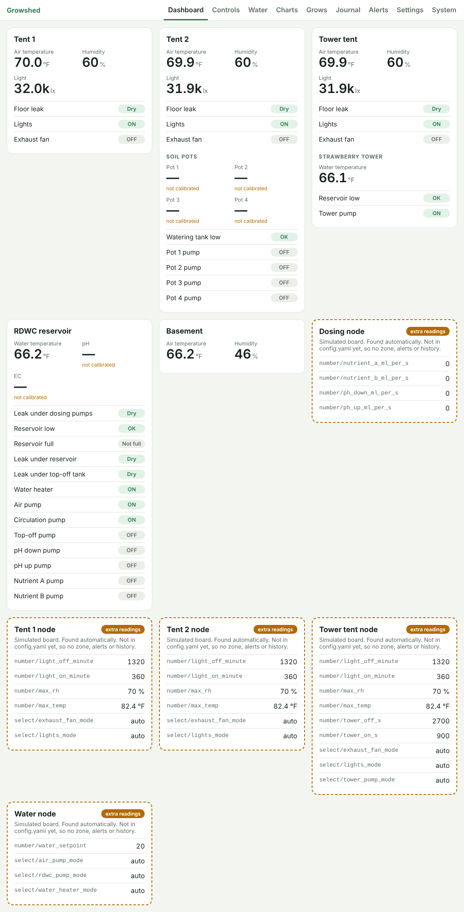
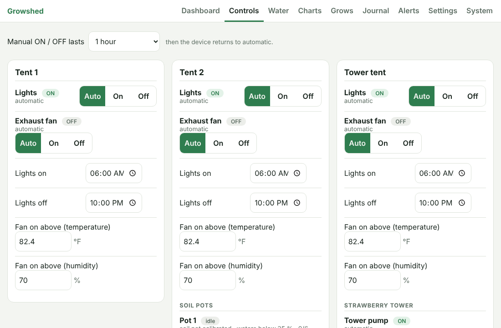
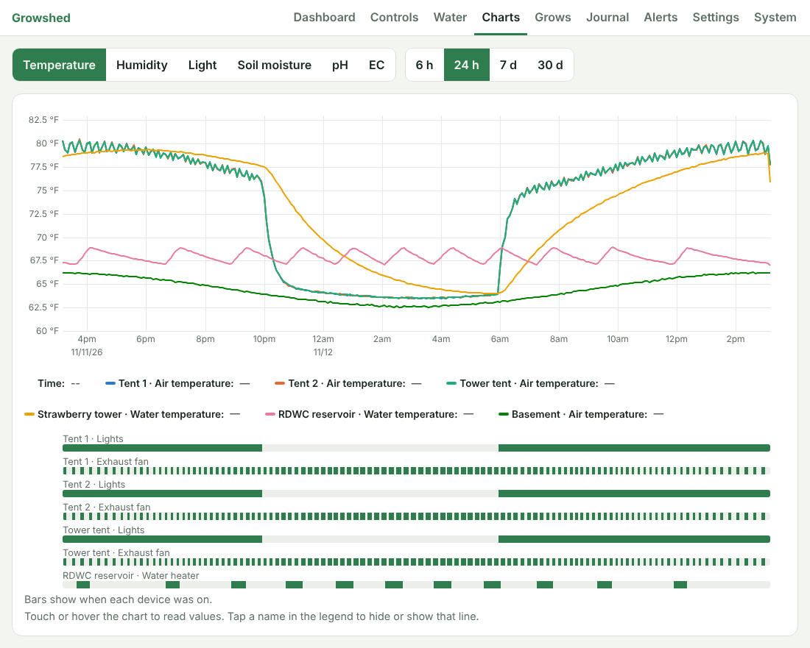
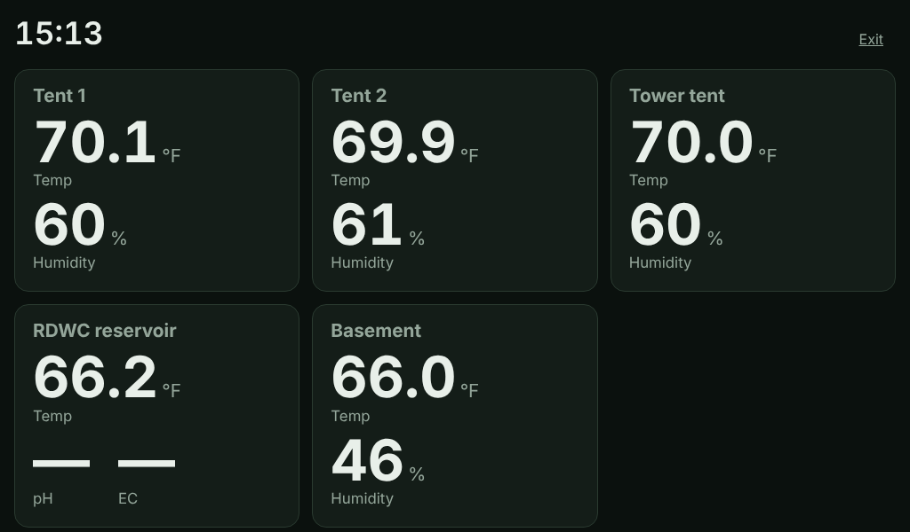

# Growshed

A home-built controller for an indoor garden in grow tents: RDWC buckets, Kratky, a strawberry
tower and soil pots. It watches the air, water and soil, switches the lights, fans, heater and
pumps, warns your phone when something is wrong, and keeps a history of every grow.

- A **Raspberry Pi 4** (the "hub") runs the web page, the history and the alerts.
- **ESP32 boards** (the "nodes"), one per tent plus one for the water and one for dosing, read
  the sensors and switch the relays. They keep the plants alive on their own if the Pi or the
  WiFi goes down.
- You use it from a **phone, laptop or wall tablet** in a normal browser. Nothing to install.



> **Where this project stands.** All the software is written and tested against a built-in
> simulator that pretends to be the hardware. **Nothing has run on real hardware yet**: no node
> has been built, and the Pi setup script has not been run on a real Pi. Expect to find and fix
> a few things on the first real install.

## Contents

- [What it does](#what-it-does)
- [Try it on a laptop first](#try-it-on-a-laptop-first-no-hardware-needed) (10 minutes, no hardware)
- [Install it for real](#install-it-for-real)
  1. [Set up the Raspberry Pi](#step-1-set-up-the-raspberry-pi)
  2. [Get alerts on your phones](#step-2-get-alerts-on-your-phones)
  3. [Build and flash the nodes](#step-3-build-and-flash-the-nodes)
  4. [First-time setup in the GUI](#step-4-first-time-setup-in-the-gui)
- [Safety](#safety-read-this)
- [Everyday use](#everyday-use): updating, backups, seeing it away from home
- [Changing what the system knows about](#changing-what-the-system-knows-about)
- [Development](#development)
- [Documentation](#documentation)

## What it does

| Page | What you get |
|---|---|
| **Dashboard** | One card per tent, the reservoir and the basement: temperature, humidity, light, soil moisture, leaks, and what is switched on |
| **Controls** | Each light, fan, heater and pump: Auto / On / Off (with "for N hours"), light times, temperature and humidity limits, watering per pot |
| **Water** | pH, EC and water temperature, pH and nutrient dosing, a log of everything added to the reservoir |
| **Charts** | Any sensor over any date range, with bars showing when each device was on |
| **Grows** | One record per grow, with its statistics kept forever so you can compare grows |
| **Journal** | Plants, notes and photos |
| **Alerts** | What is wrong now, what went wrong before, acknowledge, test notification |
| **Settings** | Light / dark theme, units, time zone, quiet hours and daily summary, alert limits, crop profiles, maintenance reminders, bottle levels, electricity cost, backups |
| **System** | Hub and node health, sensor calibration |
| **Kiosk** (`#/kiosk`) | A big, glanceable view for the wall tablet |

| | |
|---|---|
|  |  |



Also built in:

- **Automation that does not depend on the Pi.** Light schedules, fan limits, the water
  thermostat and the tower pump cycle run on the nodes all the time.
- **Safety cutoffs on the nodes**: a leak stops every water pump, a dry reservoir turns the
  heater off, an overheating tent turns the lights off, and more ([SAFETY.md](docs/SAFETY.md)).
- **Phone notifications** through the free ntfy app, with quiet hours (leaks always get through)
  and a daily summary.
- **Automatic soil watering** in small measured doses, which stops itself if the soil does not
  get wetter.
- **pH and nutrient dosing**, off by default, with a "suggest and approve" mode.
- **Built for cheap sensors.** Soil, pH and EC probes are calibrated in the GUI, and a sensor
  that has not been calibrated shows "not calibrated" instead of a made-up number.
- **Nightly backups** and a one-button full download.

## Try it on a laptop first (no hardware needed)

This runs the whole system with fake tents so you can click around before buying anything.

**You need:** [Docker Desktop](https://www.docker.com/products/docker-desktop/) (Windows / Mac)
or Docker Engine (Linux), and [Git](https://git-scm.com/downloads).

1. Get the code:

   ```bash
   git clone https://github.com/PapaBear1981/Growshed.git
   ```

   ```bash
   cd Growshed
   ```

2. Create the settings file (the defaults are fine for trying it out):

   ```bash
   cp .env.example .env
   ```

3. Start it. The first start takes a few minutes while it builds:

   ```bash
   docker compose --profile sim up -d --build
   ```

4. Open <http://localhost:8000>. You should see three tents, the reservoir and the basement with
   live (simulated) readings.

To stop it:

```bash
docker compose --profile sim down
```

<details>
<summary><b>Make the simulator misbehave</b> (leaks, dead sensors, dry soil)</summary>

Send a fault to a fake node (`tent1`, `tent2`, `tent3`, `water`, `dosing`). For example, a leak
in tent 1 (the password is `MQTT_NODE_PASSWORD` from your `.env`):

```bash
docker compose exec mosquitto mosquitto_pub -u node -P change-me-node -t growshed/sim/tent1/fault -m "leak on"
```

| Node | Faults |
|---|---|
| any | `leak on`, `leak off`, `sensor_fail on`, `sensor_fail off`, `offline`, `online` |
| `tent2` | `soil_dry`, `soil_water`, `soil_unplug`, `soil_replug`, `tank_low on`, `tank_low off` |
| `tent3` | `tower_low on`, `tower_low off` |
| `water` | `drain`, `ph_buffer 7`, `ph_buffer off`, `ec_solution 1413`, `ec_solution off`, `ph_set 7.4`, `ec_set 500` |
| `dosing` | `empty ph_down`, `refill ph_down` (also `ph_up`, `nutrient_a`, `nutrient_b`) |

`ph_buffer` and `ec_solution` pretend the probe is sitting in calibration liquid, so you can
practise the calibration steps on the System page.

</details>

## Install it for real

### What to buy

The full parts list with rough prices is in [docs/HARDWARE.md](docs/HARDWARE.md). In short:

- **Hub:** Raspberry Pi 4, a USB SSD to boot from, a power supply and a case.
- **Nodes:** ESP32 DevKit boards (WROOM-32, the common 30- or 38-pin kind), one per tent, one
  for the water, one for dosing. Arduinos, Teensys and Raspberry Pi Picos will **not** work
  ([why, and which boards do](firmware/README.md#supported-boards)).
- **Per node:** a 12 V wall adapter, a 12 V → 5 V buck converter, a fuse, and the sensors for
  that node.
- **Mains switching:** pre-built, enclosed relay outlet boxes (e.g. Digital Loggers IoT Power
  Relay). Never bare relay boards on mains.
- **A printed case** for each node: [hardware/enclosure/](hardware/enclosure/README.md) has
  ready-to-print STL files.

### Step 1: Set up the Raspberry Pi

1. **Flash the SSD.** On your computer, use
   [Raspberry Pi Imager](https://www.raspberrypi.com/software/) to write
   *Raspberry Pi OS Lite (64-bit)* to the USB SSD. In the imager's settings, set:
   - hostname: `growshed`
   - a username and password
   - your WiFi (skip if you use an Ethernet cable, which is more reliable)
   - SSH: enabled
2. **Boot the Pi** from the SSD (no SD card inserted) and log in from your computer:

   ```bash
   ssh YOUR_USERNAME@growshed.local
   ```

3. **Get the code:**

   ```bash
   sudo apt-get install -y git && git clone https://github.com/PapaBear1981/Growshed.git && cd Growshed
   ```

4. **Run the setup script.** It installs Docker and Tailscale, turns on the watchdog that
   restarts a frozen Pi, and creates `.env` with random passwords:

   ```bash
   sudo deploy/pi-setup.sh
   ```

5. **Reboot:**

   ```bash
   sudo reboot
   ```

6. **Log in again and start the hub** (the first start takes a while on a Pi):

   ```bash
   cd Growshed && docker compose up -d --build
   ```

7. On a phone or laptop on the same WiFi, open **<http://growshed.local:8000>**.
   The dashboard will be empty until the nodes are flashed. It starts by itself after every
   reboot or power cut.

If `growshed.local` does not open (some Android devices), use the Pi's IP address instead:
run `hostname -I` on the Pi and open `http://THAT_ADDRESS:8000`.

More detail and troubleshooting commands: [deploy/README.md](deploy/README.md).

### Step 2: Get alerts on your phones

1. Install the free **ntfy** app (Android or iPhone) on both phones.
2. On the Pi, show the notification address the setup script made for you:

   ```bash
   grep NTFY_URL .env
   ```

   It looks like `https://ntfy.sh/growshed-3f9a…`. In the ntfy app, subscribe to the last part
   (`growshed-3f9a…`).
3. In Growshed, open **Alerts** and press **Send a test notification**.
4. In the ntfy app's settings for that topic, let it break through Do Not Disturb, so a leak at
   3 a.m. wakes you.

Optional but worth it: [a free healthchecks.io check](deploy/README.md#phone-notifications)
tells you when the Pi itself has died, since a dead Pi cannot send alerts.

### Step 3: Build and flash the nodes

Build one node at a time, starting with a tent node. Wiring diagrams and soldering steps are in
**[docs/BUILD.md](docs/BUILD.md)**.

1. **Wire the node** following [docs/BUILD.md](docs/BUILD.md).
2. **Make the secrets file** on the Pi:

   ```bash
   cp firmware/secrets.example.yaml firmware/secrets.yaml
   ```

   ```bash
   nano firmware/secrets.yaml
   ```

   Fill in your WiFi name and password, your time zone, any long random OTA password, and the
   node password. Show the node password with:

   ```bash
   grep MQTT_NODE_PASSWORD .env
   ```

3. **Check which board you have** (plug it into the Pi by USB first). It prints the `board:`
   line to put in the node file, e.g. `firmware/tent1.yaml`. A plain ESP32 DevKit needs no
   change.

   ```bash
   python3 -m tools.detect_boards
   ```

4. **Start the flashing tool:**

   ```bash
   docker compose --profile esphome up -d
   ```

5. Open **<http://growshed.local:6052>**, pick the node (e.g. `tent1`) and choose
   *Install → Plug into the computer running ESPHome Dashboard*. **Unplug the node's 12 V
   supply while it is on USB.** Later updates go over WiFi.
6. Within a minute the node shows up on the Growshed dashboard.

Node files: `tent1.yaml`, `tent2.yaml` (with soil pots), `tent3.yaml` (strawberry tower),
`water.yaml`, `dosing.yaml`. More in [firmware/README.md](firmware/README.md).

### Step 4: First-time setup in the GUI

Work down this list once the nodes are online.

- [ ] **Settings → time zone and units.** Press the button to use your device's time zone.
- [ ] **Settings → theme.** Light, dark, or follow the device.
- [ ] **Controls → light times and limits** for each tent.
- [ ] **System → calibrate the sensors.** Soil sensors (dry, then wet), pH (two buffer
      solutions), EC (one calibration solution). Follow the on-screen steps; the hub captures
      each point itself once the reading is steady. Until then they show "not calibrated".
- [ ] **Settings → crop profile** per tent (lettuce and leafy greens, herbs, strawberries) to
      fill in sensible alert limits and targets, then adjust any limit you like.
- [ ] **Settings → electricity.** Enter each device's wattage (a plug-in watt meter helps) and
      your price per kWh for a running cost estimate.
- [ ] **Settings → quiet hours and daily summary.**
- [ ] **Settings → reminders and bottle levels** (probe calibration, reservoir change, filters).
- [ ] **Grows → Start a grow**, so history is filed under it.
- [ ] **Settings → Download full backup**, and keep the file somewhere other than the Pi.
- [ ] **Wall tablet:** open `http://growshed.local:8000/#/kiosk` and keep the screen awake.

Leave soil watering and dosing **off** until you have watched the readings for a week or two
and trust them. When you are ready:

- **Soil watering:** Controls → set the pot to Auto. Test with "water now" first, with the
  pot in its saucer.
- **Dosing:** Water → measure each pump's flow into a measuring cup, then choose **Suggest**.
  The hub proposes one small dose at a time and you approve it.

## Safety (read this)

This puts water and mains electricity in your basement, often with nobody watching.

- **Read [docs/SAFETY.md](docs/SAFETY.md) before wiring anything.** GFCI on every outlet, spill
  trays under every reservoir, a leak sensor in every tray, top-off from a jug and never from
  house plumbing, a smoke detector in the room.
- **Automatic dosing can kill your plants if a probe is wrong.** It is off by default. Turning
  on fully automatic mode shows a warning you must accept. Start with Suggest mode, and keep a
  handheld pH/EC pen to cross-check.
- **The web page has no login.** Anyone who can reach it can switch your pumps. Keep it on your
  home network and use Tailscale for access away from home. **Never forward a router port to
  it or put it on the public internet.**
- The safety cutoffs live in the node firmware and cannot be changed from the GUI.

## Everyday use

**Updating** (on the Pi, in the `Growshed` folder):

```bash
git pull && docker compose up -d --build
```

**Backups.** The hub saves a snapshot every night to `data/backups/` (14 kept). They are on the
same SSD, so also press **Settings → Download full backup** now and then.
[Restoring a backup](deploy/README.md#backups-and-restoring).

**Seeing it away from home.** On the Pi, run this once and follow the link it prints:

```bash
sudo tailscale up
```

Install the free Tailscale app on your phones and sign in with the same account. The page then
works from anywhere at `http://growshed:8000`, without exposing it to the internet.

**Is it running?**

```bash
docker compose ps
```

```bash
docker compose logs -f backend
```

## Changing what the system knows about

Tents, nodes, sensors, devices, soil pots and default alert rules are all listed in
[`config/config.yaml`](config/config.yaml). Adding a tent means adding it there and flashing
one more node; no code changes. Restart the hub after editing:

```bash
docker compose up -d --build
```

Limits you tune day to day (alert thresholds, dosing targets, watering thresholds) are on the
Settings page instead, and override the defaults in the file.

## Development

The project is "vibe coded": the owners direct and test, an AI writes the code. The rules it
works under are in [CLAUDE.md](CLAUDE.md).

```bash
pip install -r backend/requirements-dev.txt
```

```bash
pytest && ruff check .
```

```bash
cd frontend && npm install && npm run build
```

Running the pieces without Docker: start a local Mosquitto broker, then
`cd backend && uvicorn growshed.main:app --factory`, `python -m simulator` from the repo root,
and `cd frontend && npm run dev` for live-reloading GUI work.

```
backend/      the hub: FastAPI, SQLite, alerts, control, dosing, calibration
frontend/     the web GUI: Svelte 4, uPlot
firmware/     ESPHome files for the nodes, board profiles, control logic and its tests
simulator/    fake nodes for running without hardware
config/       config.yaml: what tents, sensors and devices exist
deploy/       Pi setup script, broker config
tools/        board detection, wiring diagram generator
hardware/     3D-printable node enclosure
docs/         plan, safety rules, architecture, build guide, wiring diagrams
```

## Documentation

- [Plan and phases](docs/PLAN.md): what is built, and what has only run in simulation
- [Safety rules](docs/SAFETY.md)
- [Hardware and power budget](docs/HARDWARE.md)
- [Building the nodes: wiring diagrams and assembly](docs/BUILD.md)
- [Node firmware, supported boards and flashing](firmware/README.md)
- [Printable node enclosure](hardware/enclosure/README.md)
- [Raspberry Pi install, notifications, backups](deploy/README.md)
- [Architecture](docs/ARCHITECTURE.md)
- [MQTT topic spec](docs/MQTT.md)
- [Instructions for coding agents](CLAUDE.md)
