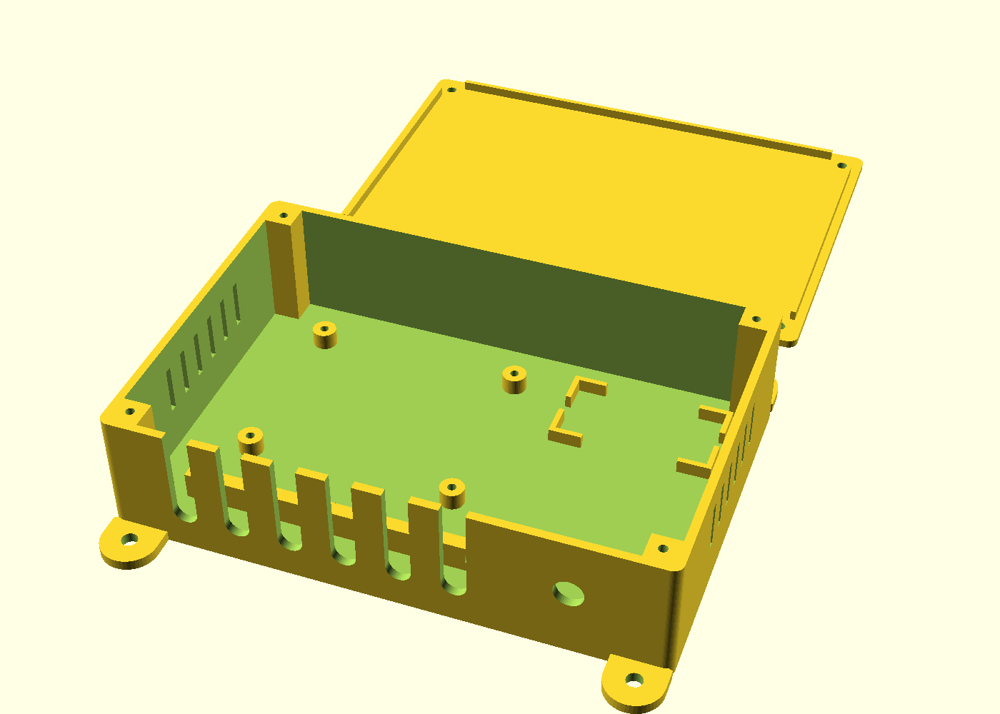

# Node enclosure (3D printed)

One box design for every ESP32 node. Two parts: `node_enclosure_base.stl` and
`node_enclosure_lid.stl`, generated from `node_enclosure.scad` (OpenSCAD).



- Outside size: 155 × 133 × 40 mm including ears (fits a 180 mm bed). Inside: 150 × 100 × 35 mm.
- Prints **without supports**, in the orientation of the STL files.
- Print in **PETG or ASA**, not PLA (PLA softens and creeps in a warm, humid grow room).
  3 perimeters, 20 % infill, 0.2 mm layers.

## What goes where

| Feature | Purpose |
|---|---|
| 4 standoffs | ESP32 screw-terminal breakout board, M3 self-tapping screws |
| Corner-bracket pocket | 12 V → 5 V buck converter (LM2596 module, 43 × 21 mm), held with foam tape |
| Open floor below the pocket (~50 × 40 mm) | Inline fuse holder, MOSFET board (water/dosing nodes) |
| 6 U-shaped slots | Cable entry. Cables with connectors already fitted drop in from the top |
| Bar with tunnels behind the slots | Strain relief: zip-tie each cable to the bar |
| 8.2 mm round hole | Panel-mount DC barrel jack (12 V in) |
| Side vents | Airflow. None on the top face, so drips can't get in |
| 4 ears, 4.5 mm holes | Screw to a wall/board, or zip-tie to a tent pole |
| Lid | 4 × M3 × 10 self-tapping screws into the corner posts |

**Mount it outside the tent, cable slots facing down**, with a drip loop in every cable.
The box is splash-resistant, not waterproof.

## Measure before you print

The standoff spacing (**60 × 50 mm**) and the barrel-jack hole (**8.2 mm**) are placeholders.
ESP32 breakout boards and panel jacks vary between sellers. Measure yours, then edit the
values at the top of `node_enclosure.scad` (`board_hole_dx`, `board_hole_dy`, `jack_d`,
`buck_l`, `buck_w`) and re-export:

```bash
openscad -D 'part="base"' -o node_enclosure_base.stl node_enclosure.scad
```

```bash
openscad -D 'part="lid"' -o node_enclosure_lid.stl node_enclosure.scad
```

If the holes don't line up and you don't want to reprint, snap off the standoffs and mount
the board with adhesive PCB standoffs or foam tape.
